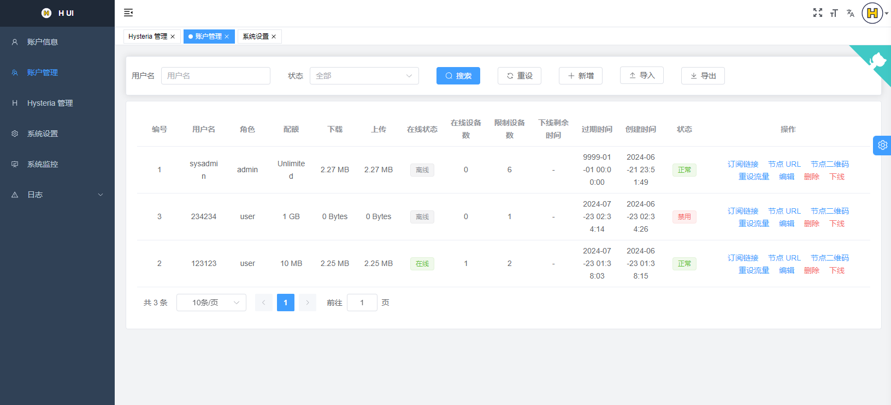

<div align="center">

<a href="https://github.com/jonssonyan/h-ui"></a>

<h1 align="center">H UI</h1>

English / [简体中文](README_ZH.md)

Just the panel for Hysteria2

<p>
<a href="https://www.gnu.org/licenses/gpl-3.0.html"></a>
<a href="https://github.com/jonssonyan/h-ui/stargazers"></a>
<a href="https://github.com/jonssonyan/h-ui/forks"></a>
<a href="https://github.com/jonssonyan/h-ui/releases"></a>
<a href="https://hub.docker.com/r/jonssonyan/h-ui"></a>
</p>



</div>

## Features

- Lightweight, low resource usage, easy to deploy
- Monitor system status and Hysteria2 status
- Limit user traffic, user online status, force users to log off, number of online users, reset user traffic
- Limit the number of users' online devices at the same time, the number of online devices
- Regular users use independent connection passwords and cannot log in to the administrator panel
- User subscription link, node URL, import and export users
- Subscription node name and server address templates with account, traffic, status, IPv4, and IPv6 variables
- Managing Hysteria2 configurations and Hysteria2 versions, port hopping
- Change the Web port, modify the Hysteria2 traffic multiplier
- View, import, and export system logs and Hysteria2 logs
- I18n: English, 简体中文
- Page adaptation, support night mode, custom page themes
- More features waiting for you to discover

## Recommended OS

OS: CentOS 8+/Ubuntu 20+/Debian 11+

CPU: x86_64/amd64 (the D10 installer does not yet support ARM64)

Memory: ≥ 256MB

## Deployment

### Quick Install (Recommended)

Install the latest stable custom release on a new Linux AMD64/systemd server:

```bash
curl -fsSL https://raw.githubusercontent.com/GlareGlimmering/h-ui/main/install.sh | sudo bash
```

Install a specified release or the latest prerelease:

```bash
curl -fsSL https://github.com/GlareGlimmering/h-ui/releases/download/v0.0.25-custom.8-rc.10/install.sh | sudo bash -s -- --version v0.0.25-custom.8-rc.10
curl -fsSL https://github.com/GlareGlimmering/h-ui/releases/download/v0.0.25-custom.8-rc.10/install.sh | sudo bash -s -- --prerelease
```

The installer verifies `SHA256SUMS` and the exact h-ui version before installation, installs the pinned `v2.13.0-hui.2` custom Hysteria2 kernel using the version metadata in h-ui, initializes the Xray data directories, creates `h-ui.service`, and performs an HTTP/frontend-asset health check. Xray itself remains optional and can be installed from Outbound Nodes.

The initial administrator username and random password are displayed once. Save them immediately. They can later be replaced with:

```bash
cd /usr/local/h-ui && sudo ./h-ui reset
```

### Manual systemd reference

Release assets: https://github.com/GlareGlimmering/h-ui/releases

```bash
mkdir -p /usr/local/h-ui/
curl -fsSL https://github.com/GlareGlimmering/h-ui/releases/latest/download/h-ui-linux-amd64 -o /usr/local/h-ui/h-ui && chmod +x /usr/local/h-ui/h-ui
curl -fsSL https://raw.githubusercontent.com/GlareGlimmering/h-ui/main/h-ui.service -o /etc/systemd/system/h-ui.service
# Custom web port, default is 8081
# sed -i "s|^ExecStart=.*|ExecStart=/usr/local/h-ui/h-ui -p 8081|" "/etc/systemd/system/h-ui.service"
systemctl daemon-reload
systemctl enable h-ui
systemctl restart h-ui
```

The legacy installer mixed program removal with permanent data deletion. A safe `uninstall`/`uninstall --purge` command is deferred; no new uninstall command is provided in D10. Back up `/usr/local/h-ui/data` and `/var/lib/h-ui` before any manual removal.

### Docker

1. Install Docker

   https://docs.docker.com/engine/install/

   ```bash
   bash <(curl -fsSL https://get.docker.com)
   ```

2. Start a container

   ```bash
   docker pull jonssonyan/h-ui

   docker run -d --cap-add=NET_ADMIN \
     --name h-ui --restart always \
     --network=host \
     -v /h-ui/bin:/h-ui/bin \
     -v /h-ui/data:/h-ui/data \
     -v /h-ui/export:/h-ui/export \
     -v /h-ui/logs:/h-ui/logs \
     jonssonyan/h-ui
   ```

   Custom web port, default is 8081

   ```bash
   docker run -d --cap-add=NET_ADMIN \
     --name h-ui --restart always \
     --network=host \
     -v /h-ui/bin:/h-ui/bin \
     -v /h-ui/data:/h-ui/data \
     -v /h-ui/export:/h-ui/export \
     -v /h-ui/logs:/h-ui/logs \
     jonssonyan/h-ui \
     ./h-ui -p 8081
   ```

   Set the time zone, default is Asia/Shanghai

   ```bash
   docker run -d --cap-add=NET_ADMIN \
     --name h-ui --restart always \
     --network=host \
     -e TZ=Asia/Shanghai \
     -v /h-ui/bin:/h-ui/bin \
     -v /h-ui/data:/h-ui/data \
     -v /h-ui/export:/h-ui/export \
     -v /h-ui/logs:/h-ui/logs \
     jonssonyan/h-ui
   ```

Uninstall

```bash
docker rm -f h-ui
docker rmi jonssonyan/h-ui
rm -rf /h-ui
```

## Default Installation Information

- Panel Port: 8081
- SSH local forwarded port: 8082

Automatic Installation ([install.sh](install.sh)):

- Login Username/Password: Random 6 characters
- Connection Password: {Login Username}.{Login Password}

Manual Installation:

- Login Username/Password: sysadmin/sysadmin
- Connection Password: sysadmin.sysadmin

Note: Only the system administrator can log in.

## System Upgrade

Upgrade to the latest stable release, latest prerelease, or a specified release:

```bash
sudo /usr/local/h-ui/h-ui upgrade
sudo /usr/local/h-ui/h-ui upgrade --prerelease
sudo /usr/local/h-ui/h-ui upgrade v0.0.25-custom.8-rc.10
```

Add `--yes` to skip the confirmation prompt. Downloads, checksums, executable permission, and the exact candidate version are checked before the running service is stopped. The upgrader creates a consistent SQLite backup plus binary, HY2 configuration, and relevant Xray configuration snapshots under `/var/lib/h-ui/backups`, retaining the five newest snapshots. A failed systemd start or panel/frontend health check automatically restores and verifies the previous version.

For manual recovery, choose the newest `upgrade-*` snapshot and consult its `manifest.json`, which maps each original path to its backup file. Stop `h-ui.service`, restore `file-0-h-ui` to `/usr/local/h-ui/h-ui` and `h_ui.db` to `/usr/local/h-ui/data/h_ui.db`, restore the other mapped files, then start the service. Automatic rollback should normally make this unnecessary; keep a copy of the snapshot before manual recovery.

## FAQ

[English > FAQ](./docs/FAQ.md)

## Performance Optimization

- Scheduled server restart

    ```bash
    0 4 * * * /sbin/reboot
    ```

- Install Network Accelerator
    - [TCP Brutal](https://github.com/apernet/tcp-brutal) (Recommended)
    - [teddysun/across#bbrsh](https://github.com/teddysun/across#bbrsh)
    - [Chikage0o0/Linux-NetSpeed](https://github.com/ylx2016/Linux-NetSpeed)
    - [ylx2016/Linux-NetSpeed](https://github.com/ylx2016/Linux-NetSpeed)

## Client

https://v2.hysteria.network/docs/getting-started/3rd-party-apps/

## Development

Go >= 1.20, Node.js >= 18.12.0

- frontend

   ```bash
   cd frontend
   pnpm install
   npm run dev
   ```

- backend

   ```bash
   go run main.go
   ```

## Build

- frontend

   ```bash
   npm run build:prod
   ```

- backend

  Windows: [build.bat](build.bat)

  Mac/Linux: [build.sh](build.sh)

## Other

You can subscribe to my channel on YouTube: https://www.youtube.com/@jonssonyan

## Contributors

Thanks to everyone who contributed to this project.

<a href="https://github.com/jonssonyan/h-ui/graphs/contributors">
  
</a>

## Star History

[](https://star-history.dera.page/#jonssonyan/h-ui&Date)

## License

[GPL-3.0](LICENSE)
